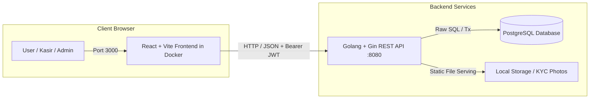
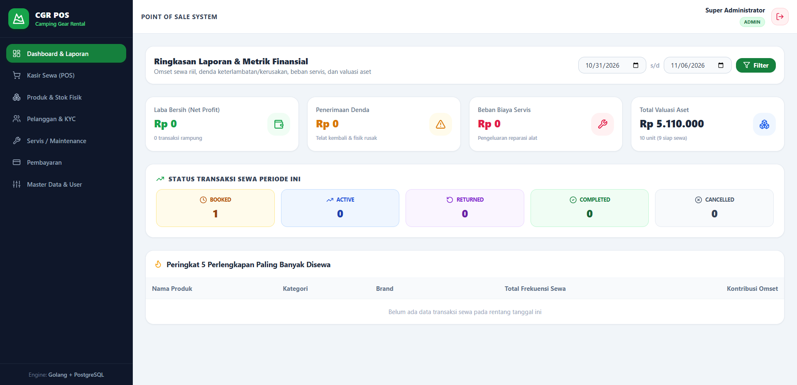
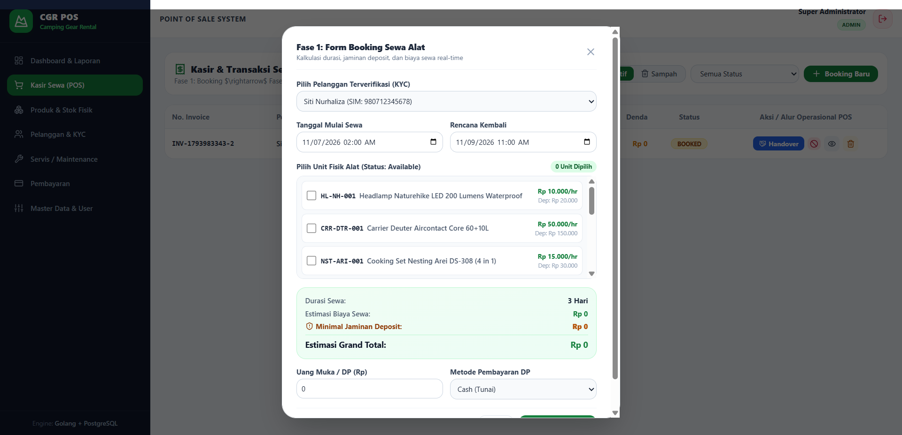
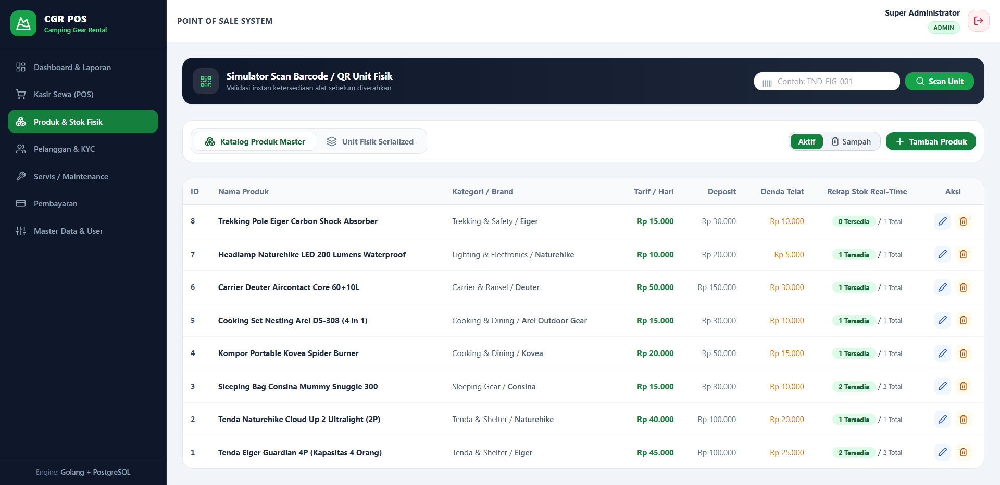
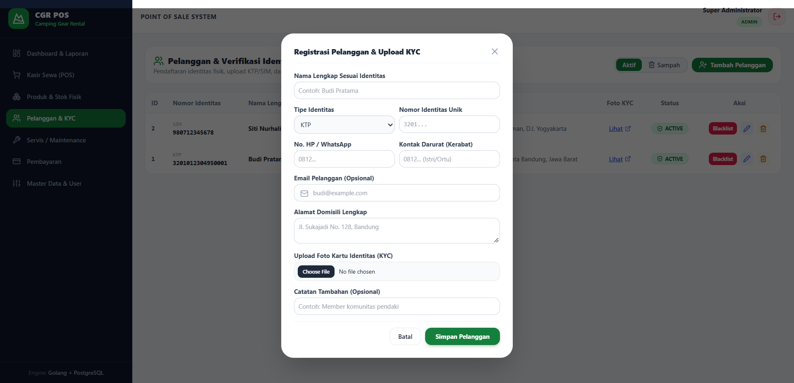
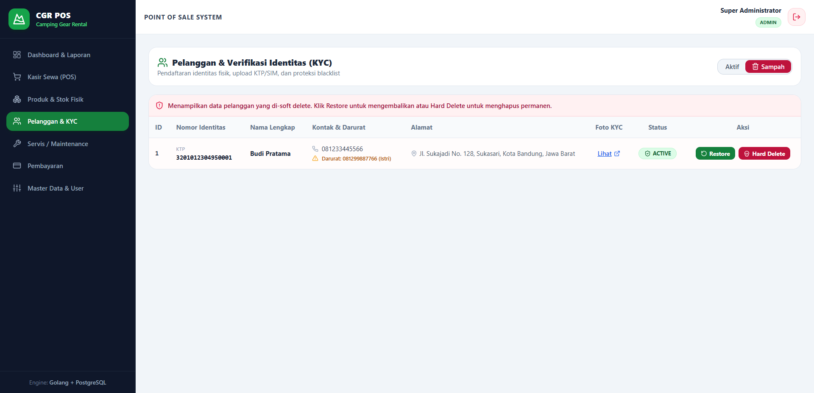

# 🏕️ Camping Gear Rental POS - Frontend Client

[](https://react.dev/)
[](https://www.typescriptlang.org/)
[](https://vitejs.dev/)
[](https://tailwindcss.com/)
[](https://www.docker.com/)
[](LICENSE)

Antarmuka Web Modern (**SPA**) untuk **Sistem Kasir & Manajemen Penyewaan Perlengkapan Camping (Camping Gear Rental Point of Sale)**. Dibangun menggunakan **React**, **TypeScript**, dan **Tailwind CSS**.


## 🏗️ Arsitektur Sistem

Aplikasi frontend berjalan secara terisolasi di dalam container Docker dan berkomunikasi secara asinkron dengan RESTful API Golang melalui Axios Client:



---

## 📸 Tampilan Antarmuka (Screenshots)

### 1. Dashboard Eksekutif & Laporan Finansial Real-Time
> *Menampilkan 4 kartu metrik keuangan (Net Profit, Denda, Beban Servis, Valuasi Aset), rasio status rental, dan peringkat 5 perlengkapan paling banyak disewa.*



### 2. Form Booking Sewa & Real-Time Estimation Box
> *Kalkulasi otomatis durasi sewa, total biaya sewa, jaminan deposit minimal, estimasi grand total, dan rekomendasi DP minimal 30% setiap kali barang dicentang.*



### 3. Pelacakan Unit Fisik Serialized & Scan Barcode
> *Pengecekan kesiapan alat camping sebelum serah terima menggunakan nomor seri dan simulator scan barcode instan.*



### 4. Pelanggan, Upload KYC & Proteksi Blacklist
> *Pendaftaran identitas fisik, upload KTP/SIM dengan pratinjau gambar, dan sistem pemblokiran otomatis pelanggan bermasalah.*



### 5. Kotak Sampah Terpadu (Trash Bin) & 1-Klik Restore
> *Fitur pemulihan data soft-deleted instan tanpa perlu mengetik ulang ID secara manual.*



## ✨ Fitur Utama

- 🔐 **Autentikasi & RBAC**:
  - Penyimpanan JWT otomatis pada `localStorage` dengan *Axios Interceptor*.
  - *Route Protection* dan *Role Guard* (`admin`, `cashier`, `staff`).
  - Sesi otomatis dibersihkan saat token kedaluwarsa atau di-*revoke* (*logout*).
- 🔄 **Siklus Sewa POS 4-Fase Lengkap**:
  - **Fase 1: Booking** $\rightarrow$ Pemilihan pelanggan KYC, pemilihan unit fisik, kalkulasi durasi & deposit instan, penguncian unit.
  - **Fase 2: Handover** $\rightarrow$ Konfirmasi serah terima fisik barang $\rightarrow$ unit menjadi `rented`.
  - **Fase 3: Return** $\rightarrow$ Pengembalian alat aktual, evaluasi kondisi (*good, damaged, lost*), dan kalkulasi denda kerusakan.
  - **Fase 4: Settlement** $\rightarrow$ Rekonsiliasi deposit vs denda $\rightarrow$ rilis unit kembali ke `available` atau `maintenance`.
  - **Batal Booking** $\rightarrow$ Pembatalan sewa yang otomatis membuka kunci unit fisik kembali.
- 📦 **Stok Serialized & Scan Barcode**:
  - Rekap stok *real-time* langsung pada kartu katalog produk.
  - Simulator input/scan barcode (`TND-EIG-001`) untuk validasi cepat.
- 🪪 **Verifikasi KYC Pelanggan**:
  - Upload file foto KTP/SIM via *Multipart Form-Data*.
  - Link pembuka foto otomatis diarahkan ke storage host backend (`http://localhost:8080/storages/...`).
  - Toggle proteksi *Blacklist* pelanggan bermasalah.
- 🛠️ **Servis & Maintenance Alat**:
  - Tiket servis manual & otomatis pasca pengembalian sewa.
  - Tombol **Selesai Servis** yang otomatis mengembalikan status unit fisik menjadi `available`.
- 💳 **Histori Pembayaran**:
  - Pencatatan DP, pelunasan, pengembalian jaminan, dan denda.
- ⚙️ **Master Data & User Management**:
  - Manajemen Kategori, Brand, Roles, dan Akun Pengguna (hashing password Bcrypt).
- ♻️ **Siklus Data Penuh di Semua Tabel**:
  - Toggle segmented: **🟢 Data Aktif** vs **🗑️ Kotak Sampah**.
  - Tombol Edit (Flexible Partial Update `PUT`), Soft Delete, **1-Klik Restore**, dan **Hard Delete (Permanen)**.

---

## 🔄 Alur Bisnis POS 4-Fase

```text
┌──────────────┐      ┌──────────────┐      ┌──────────────┐      ┌─────────────────────────┐
│  1. BOOKING  │ ───> │ 2. HANDOVER  │ ───> │  3. RETURN   │ ───> │      4. SETTLEMENT      │
└──────────────┘      └──────────────┘      └──────────────┘      └─────────────────────────┘
 • Status: booked      • Status: active      • Status: returned    • Status: completed
 • Unit: booked        • Unit: rented        • Denda dihitung      • Rekonsiliasi Deposit
 • Catat DP                                                        • Unit: available/maintenance
```

## 🚀 Panduan Instalasi & Menjalankan

### 1. Masuk ke Direktori Proyek
```bash
cd react-camping-gear-rental-pos
```

### 2. Pastikan File `.env` Sudah Benar
Pastikan alamat backend mengarah ke port API Golang Anda:
```env
VITE_API_BASE_URL=http://localhost:8080/api
```

### 3. Jalankan Container via Docker Compose
Jalankan perintah ini di terminal:
```bash
docker compose up --build
```
> *Docker akan mengunduh dependensi, menyinkronkan `node_modules` ke folder proyek Anda, dan menyalakan server Vite.*

### 4. Buka Aplikasi di Browser
Setelah container berstatus *Running*, buka tautan:  
👉 **`http://localhost:3000`**

## 👤 Kredensial Default

Gunakan kredensial Super Admin bawaan sistem backend:

| Key | Value |
| :--- | :--- |
| **URL Aplikasi** | `http://localhost:3000` |
| **Username** | `admin` |
| **Password** | `password123` |
| **Role** | `admin` (Super Administrator) |

## 📖 Dokumentasi Terkait
**Backend Repository**: `https://github.com/haritsnb/golang-camping-gear-rental-pos-api` (Golang + Gin + PostgreSQL)

## 📄 Lisensi
Didistribusikan di bawah lisensi [Apache-2.0 License](LICENSE).
